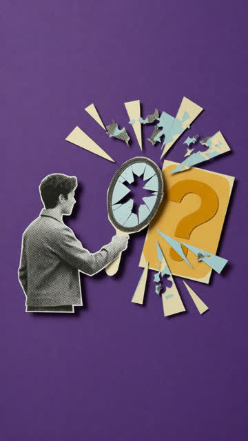
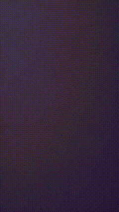
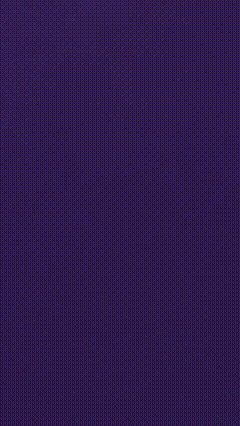
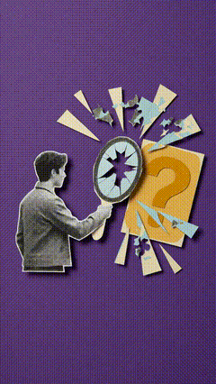
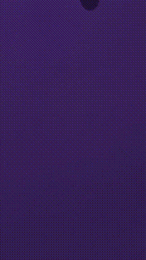

<div align="center">

# grok-collage-broll

短口播 → 9:16 半调纸拼贴 B-roll 自动化生成技能。先锁静帧，再让纸片自己拼上桌。

[](LICENSE)


[演示效果](#演示) · [安装步骤](#安装) · [方案对比](experiments/scheme-compare/)

</div>

---

先确认隐喻，再确认静帧，最后才用 **`reference_to_video`**（空色场 + 已确认静帧）做 assemble-from-empty。产物写在当前工作区 `.hyperframes-projects/`。

```text
口播一句  →  只谈隐喻（停）  →  image_gen 静帧（停）  →  空场+静帧 reference_to_video  →  无声 MP4
```

| | 默认 |
|---|------|
| 画幅 / 时长 | 9:16 · **6s**（或 10s）· 优先 720p · **无声** |
| 静帧 | Grok **`image_gen`** |
| 视频 | Grok **`reference_to_video`**（空场 + 确认静帧） |
| 落盘 | **`<workspace>/.hyperframes-projects/…`** |
| 不需要 | `GEMINI_API_KEY` · `google-genai` · Omni / Veo 脚本 |

触发：`/grok-collage-broll` · `collage b-roll` · `纸拼贴 b-roll` · `半调拼贴` · `拼贴风格配画面`

---

## 演示

同一句口播、同一静帧下的四种 Gate 3 路径（详见 [`experiments/scheme-compare/`](experiments/scheme-compare/)）。

*「很多人以为 AI 是来替你思考的，其实它更像一面镜子，会把你问题里的漏洞照出来。」*

<p align="center">
  
</p>

<p align="center">
  <a href="assets/demo-c-reference.mp4"></a>
  <a href="assets/demo-a-empty-i2v.mp4"></a>
  <a href="assets/demo-d-hold.mp4"></a>
  <a href="assets/demo-b-multishot.mp4"></a>
</p>

| | 效果 | 用途 |
|---|------|------|
| **C** [`demo-c-reference`](assets/demo-c-reference.mp4) | 空场 → 拼上 → 贴住静帧 | **默认** |
| A [`demo-a-empty-i2v`](assets/demo-a-empty-i2v.mp4) | 中段有组装，末帧易跑飞 | 不推荐默认 |
| D [`demo-d-hold`](assets/demo-d-hold.mp4) | 几乎贴静帧，几乎不动 | 末帧失败时保底 |
| B [`demo-b-multishot`](assets/demo-b-multishot.mp4) | 多段拼接（GIF 加速预览） | 实验路径 |

评分：[`QUALITY_REPORT.md`](experiments/scheme-compare/QUALITY_REPORT.md)

---

## 和 Omni 方案差在哪

- 生成走 Grok Build 工具，不配 Gemini key、不装 `google-genai`
- Gate 3 默认 **空场 + 静帧 `reference_to_video`**（空场单喂 `image_to_video` 末帧常重画）
- 中间产物在 **工作区** `.hyperframes-projects/`，不写 home
- 仓库内带路径对照实验，默认值有成片依据

完整规则见 [`SKILL.md`](SKILL.md)。

---

## 安装

```bash
git clone https://github.com/chius-me/grok-collage-broll.git ~/.grok/skills/grok-collage-broll
# 需要 ffmpeg：brew install ffmpeg
bash ~/.grok/skills/grok-collage-broll/scripts/check_setup.sh
```

```text
collage b-roll：把这句做成拼贴垫镜 —— ……
```

会停两次；你说「通过」之前不应生成视频。

---

## 输出目录

```text
.your-repo/
└── .hyperframes-projects/
    └── 2026-07-22-collage-broll-镜子/
        ├── brief.md · visual-spec.json · gate2-qa.md · gate3-qa.md
        ├── still-contact-sheet.jpg
        └── 01-镜子/
            ├── frames/first-frame.png      # 同色空场
            ├── frames/last-frame.png       # 确认静帧
            └── video/run-v01/
                ├── final-noaudio.mp4       # 交付
                ├── contact-sheet.jpg
                └── end-frame-comparison.jpg
```

后处理脚本：`scripts/prepare_empty_first_frame.sh` · `strip_audio.sh` · `make_*_contact_sheet.sh` · `compare_end_frame.sh`

---

## FAQ

| 问题 | 短答 |
|------|------|
| 为啥两次确认？ | 错隐喻改字便宜；错静帧比重跑视频便宜。 |
| 为啥 6 秒？ | Grok 视频工具时长目前只有 6 / 10。 |
| 末帧歪了？ | 确认 `images=[空场, 静帧]` 走默认 C；再不行用 D hold。 |

---

## 仓库结构

```text
grok-collage-broll/
├── SKILL.md
├── assets/
├── experiments/
├── scripts/
├── evals/ · agents/
└── README.md
```

---

## 致谢与许可

本仓库是 [pyang5166/gbro-collage-broll](https://github.com/pyang5166/gbro-collage-broll) 的 **Grok Build 实现**。

Distributed under the [MIT](LICENSE) License.

---

<div align="center">
  <sub>Crafted with ❤️ by <a href="https://chius.cc">Chius</a></sub>
</div>
